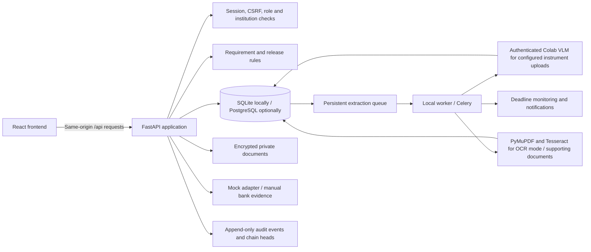
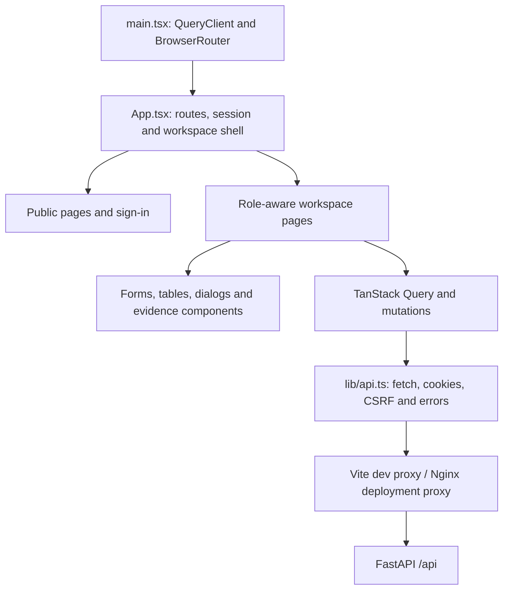

# AICTE DepositFlow — SIH26265

DepositFlow is a working prototype for managing institutional security deposits and Fixed Deposit Receipts (FDRs): submission, document review, bank evidence, maturity monitoring, renewal, clearances and release authorisation.

The project includes a **React/TypeScript frontend**, a **FastAPI backend**, a relational database, encrypted document storage, Colab VLM integration, OCR for supporting documents, role-based workflows and automated tests. **The recommended local setup uses SQLite and runs without Docker.** PostgreSQL, MinIO and Redis/Celery are included as an optional deployment configuration.

This is a Smart India Hackathon prototype, not an official AICTE service or a certified production deployment. Demo institutions and bank records are fictional; regulatory rules are illustrative. The portal records release decisions and completion references; it never transfers money.

**Deploy the web prototype without VLM:** follow [Vercel frontend + Render backend](docs/VERCEL_RENDER.md). The Render Blueprint uses external PostgreSQL and private S3-compatible storage; the API address for Vercel is set in `frontend/vercel.json`.

## Current implementation

| Area | Included |
| --- | --- |
| Institutions | Institution/programme records, scoped access and development registration |
| Deposits | Drafts, requirement calculations, instrument details, submission and status tracking |
| Documents | PDF/PNG/JPEG validation, encrypted storage, authenticated previews and extraction |
| Evidence review | Separate institution declarations, extracted fields, human corrections and bank findings |
| Review tasks | Explainable mismatch, shortfall, coverage, lien, depositor, duplicate, reuse, document-integrity, receipt-arithmetic and maturity flags; tasks reopen on new evidence and high-severity resolutions need a second officer |
| Risk | Explainable 0–100 **suspicion** score with history (officials only), risk-ordered queue and dashboard view. The score is shown only when something suspicious is found (altered or reused documents, duplicates, evidence contradicting the declaration); a case with nothing suspicious shows "No concerns" and no number |
| Verification boundary | An officer can mark verification complete only when the bank has confirmed, the receipt is uploaded and checked, every review task is resolved and no escalation remains. Release cannot be requested without it, and the sign-off is withdrawn if the evidence changes |
| Escalation | A suspicion score of 50 or more escalates the case to the Vigilance cell. The case officer cannot resolve its suspicious findings; only Vigilance can, and only Vigilance can clear the escalation |
| Verification | Labelled simulated bank adapter and officer-recorded manual bank evidence |
| Monitoring | Maturity, validity, regulatory and renewal deadlines; reminders and overdue escalations |
| Renewals | Linked replacements that preserve the previous instrument and its documents |
| Releases | Required documents, PGRC/Vigilance clearances, maker-checker checks and final decisions |
| Administration | Users, versioned rules, second-administrator rule approval, workflow and alert settings |
| Reporting | Dashboards, charts, searchable tables, CSV exports, printable reports and audit history |
| Reliability | Persistent extraction claims, bounded retries, recovery and rejection of stale worker results |

**Gemma 3 27B VLM integration is available through an authenticated Colab HTTP worker.** See [Team testing with the shared Colab VLM](docs/TEAM_TESTING.md) for fresh-checkout setup, connection checks, test receipts and the full workflow. Each teammate can run the portal locally while sharing one running model. OCR remains the default without VLM configuration and handles supporting documents. The active database stack is SQLAlchemy with SQLite/PostgreSQL; MongoDB is not used.

## Start here: clone, connect Colab, and test the VLM

**[Complete setup: laptop → ngrok → Google Colab](docs/VLM_SETUP.md)** covers a new teammate's installation, model-folder access, GPU setup, ngrok account/token/domain, notebook cell order, environment import and troubleshooting.

| Where | What runs there |
| --- | --- |
| Each teammate's laptop | React UI, FastAPI backend, SQLite database and encrypted documents; no GPU required |
| Colab owner's GPU runtime | Gemma 3 27B base + trained LoRA adapter and authenticated extraction API |
| ngrok | HTTPS tunnel from each laptop backend to the Colab worker |

To use an existing team worker, obtain its current `backend-vlm.env` privately from its owner, then run on your laptop:

```bash
git clone --branch llm_integerate https://github.com/alokkumardalei-wq/SIH_FDR.git
cd SIH_FDR
python3.12 -m venv .venv
.venv/bin/python -m pip install -r backend/requirements.lock
npm --prefix frontend ci
.venv/bin/python scripts/connect_vlm.py "$HOME/Downloads/backend-vlm.env"
.venv/bin/python scripts/prepare_team_demo.py
python3 scripts/dev.py
```

Open **http://localhost:5173**. Use `institution@demo.local` / `demo@#%1234567890` for the default demo. Follow the [two-receipt and role-by-role test guide](docs/TEAM_TESTING.md). Use Python 3.12 and Node.js 22; Windows users can follow the WSL paths in the complete guide. The private repository requires collaborator access.

To run **your own Colab worker**, obtain the complete saved adapter export in Drive and upload [Gemma3_27B_Review_and_Serve.ipynb](training/gemma3_27b/Gemma3_27B_Review_and_Serve.ipynb) to Colab. Use the recorded A100 80 GB class, configure `ROOT`, leave `RUN_EVALUATION=False`, and run setup, model loading, inference and the API smoke test in order. Add `NGROK_AUTHTOKEN` and `NGROK_DOMAIN` in Colab Secrets, then run the server cell with `START_WORKER=True`. It downloads the connection file used above. [Detailed instructions and recovery steps](docs/VLM_SETUP.md#4-run-the-saved-model-in-colab).

The model weights stay in Drive/Colab; **cloning code alone does not grant model access or start a worker**. A teammate sharing your running worker needs only its current connection file. Each laptop has independent cases; a shared model does not share databases. Keep the Colab worker running, and re-import new settings/restart the backend whenever the runtime or credentials change.

## Run locally without Docker

### Prerequisites

- Python **3.12** and its virtual-environment support.
- Node.js **22**, npm and Git.
- Tesseract for scanned PDFs and images. Selectable-text PDFs can be processed without it.

The commands below target macOS/Linux. On Windows, WSL provides the same shell and paths.

### Install and start

```bash
git clone --branch llm_integerate https://github.com/alokkumardalei-wq/SIH_FDR.git
cd SIH_FDR
python3 -m venv .venv
.venv/bin/python -m pip install -r backend/requirements.lock
npm --prefix frontend ci
python3 scripts/dev.py
```

Open:

| Service | URL |
| --- | --- |
| Portal | http://localhost:5173 |
| Interactive backend API documentation | http://127.0.0.1:8000/docs |
| API health | http://127.0.0.1:8000/api/health |

The launcher applies Alembic migrations, seeds fictional demo data idempotently and starts the API and frontend. It preserves existing accounts and records. Press **Ctrl+C** in that terminal to stop both services.

Use `http://localhost:5173` consistently. The configured origin protects write requests; opening the frontend through `127.0.0.1` instead can cause origin errors. Backend automatic reload is disabled to reduce local overhead: restart the launcher after Python changes. Frontend changes use Vite hot reload.

No `.env` file is required for the default OCR setup. VLM connections use private settings in `backend/.env`. A fresh checkout should omit local keys and runtime data; development keys are generated locally on first use. Existing installations must preserve their encryption keys to keep stored documents readable.

Install Tesseract if needed:

```bash
# macOS
brew install tesseract

# Debian / Ubuntu
sudo apt-get install tesseract-ocr tesseract-ocr-eng
```

### Run the two services separately

From the repository root, prepare and run the backend:

```bash
cd backend
../.venv/bin/python -m alembic upgrade head
../.venv/bin/python -m app.seed
../.venv/bin/python -m uvicorn app.main:app --host 127.0.0.1 --port 8000 --no-access-log
```

In another terminal, from the repository root:

```bash
npm --prefix frontend run dev -- --host 127.0.0.1
```

Run backend commands inside `backend/`, so the database, private key file and storage paths resolve consistently. Use either the combined launcher or the separate commands, not both at once.

## Demo accounts and roles

**There are two sign-in doors.** The sign-in page has an **Institute** and an **Admin** toggle: institutions use the Institute Portal, and every AICTE official uses the AICTE Admin Command portal. Each door admits only its own accounts. Inside the Admin portal, a demo-only **Acting as** menu in the header signs you in as another official (second administrator, verification officers, PGRC, Vigilance, authority, auditor), so one presenter can walk a case through every stage. These remain separate accounts on the server, so maker-checker rules still hold: a second officer confirms high-severity resolutions, a second administrator approves rule changes, and only Vigilance clears escalations. The menu appears only when the backend reports demo mode.

The sign-in page provides one-click shortcuts for the fictional demo accounts. The public, local-demo password is **`demo@#%1234567890`**. This is a fixture password, not a private deployment credential. Set `DEMO_PASSWORD` before the first seed to choose another value; reseeding does not reset existing accounts. If changed, enter the selected password manually instead of relying on the demo shortcut.

| Account | Purpose |
| --- | --- |
| `institution@demo.local` | Meridian Institute: create deposits, upload documents, answer review queries and request release |
| `institution2@demo.local` | Sahyadri College: demonstrate institution-level isolation |
| `institution3@demo.local` | Northstar School: demonstrate an unavailable simulated bank response |
| `officer@demo.local` | Claim cases, scrutinise evidence, verify instruments, resolve review tasks and mark verification complete once every requirement is met |
| `officer2@demo.local` | Second verification officer who confirms or rejects high-severity resolutions |
| `clearance@demo.local` | Record PGRC clearance decisions |
| `vigilance@demo.local` | Record Vigilance clearance decisions; resolve suspicious findings on escalated cases and clear escalations |
| `authority@demo.local` | Decide release requests and record completion references |
| `admin@demo.local` | Manage accounts, configuration, rule proposals and monitoring |
| `admin2@demo.local` | Provide the separate administrator needed to approve a rule change |
| `auditor@demo.local` | Read permitted records, audit events and reports |

There are **six application roles**: institution, verification, clearance, authority, admin and auditor. PGRC and Vigilance are separately scoped cells within the clearance role. Backend checks enforce permissions independently of which buttons are visible.

The seed includes three institutions, nine deposit obligations and ten instruments, including a preserved predecessor. PDFs in `demo-data/` are explicitly fictional demonstration documents. Personal accounts, uploaded real documents and local database records are not included in the repository.

## Typical case journey

1. **Institution:** select a programme, review the configured requirement, create a draft and upload the FDR receipt.
2. **Extraction:** the backend reads the document and stores original text, fields and confidence. The institution can record a reasoned correction without replacing the original extraction.
3. **Verification officer:** claim the case, compare the independent evidence sources, request clarification and resolve review tasks with reasons.
4. **Bank evidence:** run a clearly labelled simulated check or record authorised manual bank confirmation with a supporting document. Until the bank answers, the case simply reads "Bank has not confirmed yet"; nothing is scored for waiting.
5. **Verification complete:** the assigned officer works through the verification checklist (bank confirmed, receipt checked, tasks resolved, no uncleared escalation) and signs the case off. If a suspicion score reaches 50 the case is escalated to Vigilance first, and the officer cannot proceed until Vigilance resolves the suspicious findings and clears it.
6. **Monitoring/renewal:** track the distinct deadlines and link any replacement instrument to the original.
7. **Release:** the institution can request release only after verification is complete, then submits the configured supporting records, including a release request, affidavit and approval letter in the demo workflow. PGRC and Vigilance record their clearance decisions.
8. **Approving authority:** review all blockers and record approval, return or rejection. A prior reviewer cannot provide the final release decision. Once authorised, record the external completion/NOC reference.

A risk flag prompts human review. It does not declare fraud or automatically authorise release. Missing confirmation or paperwork is a requirement that blocks verification, not a score. Because an official can also be wrong or corrupt, no single officer can clear a suspicious case. Bank maturity alone does not establish release eligibility.

## Backend architecture

The backend is a **modular monolith**: one FastAPI application owns authentication, access control, transactions and workflow decisions. It uses SQLAlchemy's synchronous ORM with Alembic migrations. Background extraction runs outside the inference-time database transaction; the local scheduler or optional Celery worker processes retained work.



### Backend module map

All application modules are under `backend/app/`.

| Module | Responsibility |
| --- | --- |
| `main.py` | FastAPI setup, route registration, lifespan scheduler, security headers and exception responses |
| `config.py` | Environment settings, development key generation and production configuration checks |
| `db.py`, `models.py`, `schemas.py` | Database sessions, normalised relational models and request validation |
| `auth_routes.py`, `security.py` | Login/logout, password hashing, revocable sessions, CSRF and scoped record access |
| `deposit_routes.py` | Institutions, calculations, drafts, submission, uploads, corrections and replacements |
| `rules.py` | Effective-dated requirement rules, exemptions, multipliers and calculation snapshots |
| `storage.py` | Upload validation, optional ClamAV scanning, Fernet encryption and local/S3 storage |
| `extraction.py` | PDF text extraction, Tesseract fallback and heuristic structured-field parsing |
| `extraction_engine.py` | PDF → OCR → VLM cascade, strict VLM response validation, preserved source evidence, completeness checks and extraction disagreements |
| `jobs.py`, `worker.py` | Persistent claims, retries, recovery, local scheduling and optional Celery tasks |
| `bank.py` | Bank adapter protocol and deterministic fictional verification fixtures |
| `workflows.py` | Discrepancy detection, release prerequisites, reviewer separation and deadline reminders |
| `matching.py`, `forensics.py`, `consistency.py` | Normalised names, banks and references; document integrity indicators (metadata, incremental saves, conflicting values, text layer against OCR); receipt arithmetic |
| `risk.py` | Suspicion-only risk score (engine 2.0.0) from review tasks and score-only observations; escalation to Vigilance at the high threshold; append-only score history and approved weight versions |
| `../evaluation/` | Synthetic labelled corpus, end-to-end harness and report for measuring the risk engine (`python -m evaluation`) |
| `review_routes.py` | Assignment, scrutiny, bank evidence, clearances and release decisions |
| `admin_routes.py` | Dashboard/report queries, user/rule administration, settings and monitoring |
| `presenters.py` | API response assembly, evidence details and exclusion of private internal fields |
| `audit.py` | Actor-attributed hash-chained events and transactionally updated chain heads |
| `seed.py` | Idempotent fictional institutions, accounts, instruments and documents |

`backend/migrations/` contains the initial schema, append-only audit triggers, extraction provenance and worker-claim/audit-head additions. Migrations run explicitly before the application; startup does not recreate the database schema.

### Data and evidence boundaries

- `security_deposits` stores the obligation, programme and requirement snapshot; `deposit_instruments` stores declared FDR details and replacement history.
- `documents` references private encrypted bytes and tracks upload/extraction state.
- `document_extractions` preserves original extracted evidence, provider and document checksum; `field_corrections` stores later human corrections separately.
- `verification_requests` and `verification_evidence` retain bank findings with an explicit simulation distinction.
- `release_requests` snapshot the required workflow; `release_clearances` records cell-specific decisions.
- `audit_logs` and `audit_chain_heads` retain and verify ordered event histories.

Money is stored using fixed-precision numeric columns. Foreign keys, unique references, checks and migrations are part of the relational model. See the [database diagram](docs/DATABASE.md) and [generated PostgreSQL schema](docs/schema.postgresql.sql).

### Authentication, documents and approvals

Authentication uses an **opaque, HttpOnly session cookie**, not a frontend-stored bearer JWT. Passwords use Argon2; only hashes of session tokens are stored. Mutations require CSRF protection, and institution access is scoped server-side. JWTs are used for short-lived, user-bound document access grants.

Uploaded documents are encrypted with Fernet before being written to local storage or S3/MinIO. Supported inputs are PDF, PNG and JPEG, up to 10 MB and 15 PDF pages, with content/format checks. ClamAV is optional locally and required by production settings. The private-document download path rechecks authentication and access.

Release approval rechecks required documents, permitted bank verification, the configured regulatory period, unresolved tasks, in-progress receipt extraction and required clearances. Prior reviewer identities remain disqualified after reassignment or a later role change. Rule changes also require a second administrator.

Audit update/delete triggers and hash chains provide tamper evidence. A privileged database owner can still defeat these protections; externally anchored audit storage is not implemented.

### Background work

Document states are `queued`, `processing`, `completed` and `failed`. Claims and attempt counts persist in the database. Local inference is limited to one extraction per process. Transient failures use bounded retries; expired claims can recover, and a late worker cannot overwrite a newer claim. The local scheduler checks retained work every five seconds. The optional Celery Beat configuration runs recovery/monitoring every five minutes.

Reminder stages default to 90, 60, 30, 7 and 0 days, plus overdue escalation. Notifications are deduplicated. In-app notifications and a development email-outbox representation are included; real email/SMS delivery is not connected.

### API surface

Endpoints use the **`/api`** prefix. Examples include `/api/auth/login`, `/api/deposits`, `/api/releases`, `/api/dashboard`, `/api/audit` and `/api/admin/monitor`. Follow the actual API contract in [docs/API.md](docs/API.md), [docs/openapi.json](docs/openapi.json), or the running `/docs` page. The repository does not implement the earlier proposed `/api/v1/fdr/*` contract.

## Frontend architecture

The frontend is a **React 19 + TypeScript single-page application**, built with Vite. React Router handles navigation; TanStack Query loads and refreshes server state. React Hook Form and Zod handle form state and validation. Recharts renders analytics. Tailwind CSS, shared CSS, Lucide icons and Radix-based UI primitives provide presentation and interactions.



### Frontend module map

| Path under `frontend/` | Responsibility |
| --- | --- |
| `src/main.tsx` | React entry point, router and query-client providers |
| `src/App.tsx` | Route tree, current-user context, authenticated shell, role-aware navigation and mobile sidebar |
| `src/pages/public.tsx` | Landing page, workflow guide, sign-in and development registration |
| `src/pages/overview.tsx` | Dashboard, registry/queues, institutions, requirement calculator, notifications, settings, reports and audit view |
| `src/pages/case.tsx` | New deposit form and detailed case workspace, including uploads and workflow actions |
| `src/pages/admin.tsx` | Release queue/decisions and administrative screens |
| `src/components/evidence-comparison.tsx` | Submitted, extracted/corrected and bank values side by side; provenance and simulation labels |
| `src/components/case-progress.tsx` | Case stages, outstanding review status and role-specific next-action guidance |
| `src/components/common.tsx` | Shared panels, tables, badges, notices, action dialogs and private document previews |
| `src/components/ui/` | Shared button/dialog primitives |
| `src/lib/api.ts` | Same-origin requests, cookie credentials, CSRF headers, API errors and CSV downloads |
| `src/lib/utils.ts`, `src/styles.css` | Labels/formatting, visual layout and responsive styles |
| `vite.config.ts` | React/Tailwind plugins, API proxy, build chunks and Vitest setup |
| `nginx.conf` | Built-SPA serving, API reverse proxy, upload limit and browser security headers |

### Screens available

Public routes are `/`, `/information`, `/signin` and `/register`. The authenticated workspace starts at `/app` and includes:

- Two portals with their own sidebars and a shared header (portal badge, search, theme switcher, notification drawer, sign-out). Institute: dashboard, new deposit and calculator, my deposits, renewals and releases. Admin: command dashboard, verification queue, Vigilance and escalations, release clearances and approvals, institutions and registry, reports and audit trail, rules and risk policy, system monitor.
- Dashboard with live database-derived indicators and charts.
- Deposit registry, new-deposit form and detailed case tabs.
- Verification and maturity queues, plus an Escalated cases queue for the Vigilance cell.
- Case verification checklist, "Mark verification complete", escalation banner and Vigilance resolve and clear actions.
- Evidence comparison, original extraction/correction history and private document preview.
- Document integrity checks for officials: what each forensic, arithmetic and reuse check examined, and whether it passed or raised a finding.
- Review tasks, bank verification and release workflow actions.
- Release requests, institutions and requirement calculation.
- Notifications, account settings, reports and audit history.
- Administration for users, rules, workflow, alerts and system monitoring.
- Management reports (pending verifications, upcoming maturities, missing documents, cases requiring intervention), filtered and paged audit search, case reassignment, and CSV import of existing records with a check before anything is saved.
- Official bank evidence records the values the bank confirmed, and any difference from the declaration becomes a review task.
- Risk policy: signal weights, caps and thresholds, an impact preview, proposals approved by a second administrator, and version history (read-only for auditors).

The interface shows actions according to role and case state, while the backend remains authoritative. Receipt screens poll while extraction is queued or processing. Human-corrected values retain the original evidence and do not inherit the parser's confidence score. Matching fields are never presented as proof of authenticity.

### Design language

The interface follows the design language in `SKILL.md`:

- **Shape, depth and type:** generous radii (16px cards, 10px controls, pill badges), layered soft shadows with hairline edges, a translucent heavier sidebar material, large tightly tracked titles, and sentence-case labels. Sizes are in `rem`, so the reader's browser text size is respected.
- **Colour:** neutral greys for content and one blue accent (`--accent`) reserved for what can be acted on (buttons, links, selection, focus); status colours only where they carry meaning; the DepositFlow wordmark keeps its navy. Colours are role-based tokens at the top of `src/styles.css`, each with a light and dark value, and text meets WCAG AA contrast in both themes. The theme follows the system unless changed under **Account settings → Appearance**; printing always uses the light theme.
- **Springs, not fixed animations** (`src/lib/spring.ts`): Apple-style damping and response; every animation starts from the current position and velocity, so it can be interrupted and reversed.
- **Gestures** (`src/components/motion.tsx`, `src/components/ui/dialog.tsx`): on phones, dialogs are bottom sheets and the navigation is a drawer. Both track the finger 1:1, rubber-band at their edges, project a flick's momentum to decide where to settle, and carry the finger's velocity into the spring. The case tabs' indicator springs toward the chosen tab.
- **Response and feedback:** controls react on press with no tap delay; centred dialogs materialise (blur and scale together) and leave the way they came; touch devices get light haptics on success, error and snap.
- **Preferences honoured:** reduced motion (cross-fades, no springs or gestures), reduced transparency (solid materials) and more contrast (defined edges, darker secondary text).

In development, Vite proxies `/api` to `127.0.0.1:8000`. The optional container build serves the compiled SPA through Nginx and proxies `/api` to the backend service. The browser does not need database credentials or a secret-bearing frontend environment file.

## Configuration and secret handling

The root `.env.example` and `backend/.env.example` templates are included in this repository. Real `.env` files remain ignored. The current branch omits `backend/.data/local-secrets.json`; fresh installations generate their own local keys. Previously committed keys remain in older Git history. Use separate environment-provided keys for deployments; do not put API keys or database passwords in frontend code.

For optional native overrides, create your own untracked `backend/.env`. Shell environment variables also work. These are the main settings:

| Setting | Local default / purpose |
| --- | --- |
| `ENVIRONMENT` | `development`; production enables stricter startup checks |
| `DATABASE_URL` | `sqlite:///./.data/depositflow.db`; can select PostgreSQL |
| `STORAGE_BACKEND`, `STORAGE_PATH` | `local`, `.data/documents` |
| `JOB_MODE` | `local`; optional `celery` deployment |
| `FRONTEND_ORIGIN` | `http://localhost:5173` |
| `COOKIE_SECURE` | `false` for loopback HTTP; required in production |
| `REQUIRE_MALWARE_SCAN`, `CLAMAV_HOST` | Optional locally; configure the scanner for production |
| `EXTRACTION_PROVIDER` | `cascade` by default for instrument receipts: PDF text layer, then Tesseract, then the Colab VLM only when both fall short of the required fields and a worker is configured. `ocr` and `vlm_http` force a single provider. Supporting documents always use local extraction |
| `EXTRACTION_MIN_CONFIDENCE` | Parser confidence (0–1, default 0.5) every core field needs for a cascade stage to stop there |
| `EXTRACTION_MAX_ATTEMPTS`, `EXTRACTION_LEASE_SECONDS` | `3`, `900` |
| `SECRET_KEY`, `STORAGE_ENCRYPTION_KEY` | Generated locally in development; explicit private values required in production |
| `DEMO_PASSWORD` | Optional password override before initial seeding |
| `S3_ENDPOINT`, `S3_BUCKET`, `S3_ACCESS_KEY`, `S3_SECRET_KEY` | Optional private S3/MinIO configuration |
| `REDIS_URL` | Broker connection for optional Celery mode |

Development runtime files live under `backend/.data/`: the SQLite database, encrypted documents and `local-secrets.json`. Runtime data and `local-secrets.json` remain ignored in the current branch. Backups, other private keys, credentials, dependency folders, builds and test artifacts remain ignored. Preserve the database, encrypted objects **and their encryption key together** in a private backup; the key is required to read existing documents.

## Optional Docker deployment

Docker is not required for the default setup. The Compose stack adds PostgreSQL, MinIO, Redis, Celery, Beat and Nginx and uses more resources. Stop the native launcher first to free ports 8000 and 5173.

```bash
python3 scripts/configure.py
docker compose up --build -d
docker compose exec api python -m app.seed
```

`configure.py` creates an ignored root `.env` with fresh deployment secrets and refuses to overwrite an existing file. The Compose migration service finishes before the API starts. Open the portal at http://localhost:5173 and MinIO's local console at http://localhost:9001. MinIO credentials remain in your generated private `.env`.

To enable the optional antivirus service, set `CLAMAV_HOST=clamav` and `REQUIRE_MALWARE_SCAN=true` in that local file, then run:

```bash
docker compose --profile malware-scan up --build -d
```

Use `docker compose down` to stop services while retaining their named volumes. Avoid `down -v` if you need to retain stored data. The optional stack is included but has not been validated end to end on this development machine.

For native PostgreSQL without Docker, set a private `DATABASE_URL` using the `postgresql+psycopg://` driver in `backend/.env`, then use the normal migration and startup commands. This selects a database; it does not automatically copy existing SQLite records.

## Tests and build

From the repository root:

```bash
cd backend
../.venv/bin/python -m pytest -q
../.venv/bin/python -m alembic check
cd ../frontend
npm test
npm run build
```

`alembic check` requires an accessible database already migrated to the current revision. The backend tests use temporary databases and storage directories; they do not reset your presentation data.

For browser tests, first start the local portal, then run in another terminal:

```bash
cd frontend
npx playwright install chromium
npm run test:e2e
```

An existing compatible Chromium executable can be selected with `PLAYWRIGHT_CHROMIUM_EXECUTABLE`. Browser tests use one worker, create fictional `E2E-*` records and retain ignored screenshots/traces under `frontend/test-results/`.

Latest validation (26 October 2026): **162 backend tests, 31 worker/setup tests, 22 frontend tests and all 6 browser workflows passed** after merging the cascade extraction and two-portal changes from main. TypeScript/production build, SQLite migrations and schema alignment passed. Browser tests used a separate database and exercised the complete submission-to-release lifecycle. The running Colab worker extracted both fictional receipts successfully; the altered receipt's ₹50 lakh amount differed from the independent mock-bank fixture's ₹35 lakh amount and produced a mismatch. These checks do not establish accuracy on unseen real receipts. See [docs/VERIFICATION.md](docs/VERIFICATION.md) for test scope and limitations.

## Troubleshooting and maintenance

| Symptom | Check |
| --- | --- |
| Browser says connection refused | Keep `python3 scripts/dev.py` running; inspect its terminal output and use port 5173 |
| Launcher reports a port is occupied | Stop the previous instance or the service using 8000/5173, then restart |
| Sign-in or mutations report an untrusted origin | Use `http://localhost:5173` or deliberately update `FRONTEND_ORIGIN` |
| Scanned document extraction fails | Install Tesseract, check it is on `PATH`, then retry the failed extraction |
| API reports missing tables/columns | Stop the backend and run `alembic upgrade head` from `backend/` |
| Python changes are not visible | Restart the backend; frontend hot reload does not reload Python |
| Docker makes the machine slow | Use the default native SQLite/local-storage mode |
| Encrypted documents cannot be read after moving data | Restore the matching encryption key together with the database and documents |

For a clean **local demo only**, stop the application first:

```bash
python3 scripts/reset_demo.py --confirm-reset
python3 scripts/dev.py
```

The reset script archives `backend/.data` before creating new demo state. Do not reset to apply an upgrade, and do not use this script against an external PostgreSQL database. For upgrades, retain a private backup and apply migrations.

## Repository layout and further documentation

```text
SIH_FDR/
├── backend/
│   ├── app/                 # API, models, security and domain services
│   ├── migrations/          # Alembic migration history
│   ├── tests/               # Backend and workflow regression tests
│   ├── requirements.lock    # Pinned Python dependencies
│   └── Dockerfile           # Optional API/worker container
├── frontend/
│   ├── src/pages/           # Public, case, overview and administration pages
│   ├── src/components/      # Shared UI and evidence/progress components
│   ├── src/lib/             # API client and formatting helpers
│   ├── e2e/                 # Playwright browser scenarios
│   ├── package-lock.json    # Locked frontend dependencies
│   └── nginx.conf           # Optional built-SPA/API reverse proxy
├── demo-data/               # Fictional PDF fixtures only
├── docs/                    # Architecture, database, API, demo and verification notes
├── scripts/                 # Native launcher, private Compose setup and demo reset
└── compose.yaml             # Optional PostgreSQL/MinIO/Redis/Celery stack
```

- [Architecture and security boundaries](docs/ARCHITECTURE.md)
- [Complete Colab/ngrok VLM setup](docs/VLM_SETUP.md)
- [Team workflow tests and demo receipt values](docs/TEAM_TESTING.md)
- [Backend progress and deferred VLM work](docs/BACKEND_PROGRESS.md)
- [Database relationships](docs/DATABASE.md) and [PostgreSQL schema](docs/schema.postgresql.sql)
- [API guide](docs/API.md) and [OpenAPI snapshot](docs/openapi.json)
- [Six-journey demo walkthrough](docs/DEMO.md)
- [Verification results](docs/VERIFICATION.md)
- [Known limitations and remaining integrations](docs/LIMITATIONS.md)
- [Risk engine evaluation](docs/RISK_EVALUATION.md)

Live bank/AICTE connectivity, production VLM hosting and real-receipt accuracy validation, real email/SMS delivery, SSO/MFA, production deployment hardening and formal regulatory review remain future work. The trained VLM can run through the temporary Colab worker. Existing automated checks assist officers; human decisions and independently obtained evidence remain essential.
