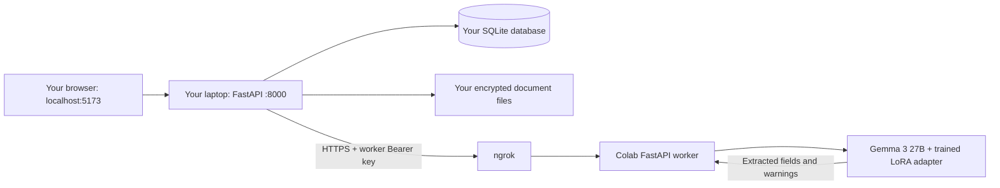

# Run the team VLM in Google Colab and connect your local portal

This guide reproduces the setup used by this project: **Gemma 3 27B runs on a Colab GPU; FastAPI, React, SQLite and document storage run on each teammate's laptop.** ngrok connects the laptop backend to Colab over HTTPS. You do not need a GPU or model weights on the laptop.

Use the notebook in `training/gemma3_27b/` to load the existing trained **Gemma 3 27B adapter** from Drive. No new model training is required.

## Choose who runs Colab

| Setup | What you need |
| --- | --- |
| Use the team's existing worker | Repository access and the owner's current `backend-vlm.env`, shared privately. Go straight to step 1, then step 5. |
| Start your own worker | Repository access, the complete trained adapter export in your Drive, a suitable Colab GPU, and your own ngrok account. Follow every step. |



The browser calls your local backend, not ngrok directly. Separate laptop installations have separate cases and accounts. Sharing a VLM does not share the database. To collaborate on the same cases, the team needs a shared backend deployment.

## 1. Clone and install on your laptop

Use **Python 3.12**, **Node.js 22/npm**, Git and internet access. The commands below are for macOS/Linux. Windows teammates should use WSL and run all commands inside WSL. The repository owner must grant access to this private repository.

Run in your laptop's terminal, such as the VS Code terminal:

```bash
git clone --branch llm_integerate https://github.com/alokkumardalei-wq/SIH_FDR.git
cd SIH_FDR
python3.12 -m venv .venv
.venv/bin/python -m pip install -r backend/requirements.lock
npm --prefix frontend ci
```

If your Python 3.12 executable is named `python3`, substitute that for `python3.12`. Do not copy another laptop's `.venv`, `node_modules`, database or encryption keys. Docker, Redis and MongoDB are unnecessary for this local setup.

Tesseract is optional for instrument uploads handled by the VLM. Install it if you will also test scanned supporting documents: `brew install tesseract` on macOS, or `sudo apt-get install tesseract-ocr tesseract-ocr-eng` on Ubuntu/WSL.

## 2. Put the trained export in the Colab owner's Drive

Git includes the worker, notebook, backend adapter, tests and demo receipts. **Git does not contain the trained weights or give access to Drive files.** Obtain the complete saved export from the model owner. The team's supplied export is in [this shared model folder](https://drive.google.com/drive/folders/12kUXkvbBhCDoZauiADW3vB8hJ3ZkI0nX?usp=sharing); access must be granted to the Google account running Colab.

Copy the export to your own Drive, or add an accessible shortcut under My Drive and use its actual mounted path. For a full copy, you can download/extract the folder and upload the complete export to Drive. Keep all processor/tokenizer files; do not copy only the adapter weight file.

The default notebook expects:

```text
MyDrive/
└── SIH26265_AICTE_VLM_27B_12B/
    ├── fine_tuned_vlm_lora/
    │   ├── adapter_config.json
    │   ├── adapter_model.safetensors
    │   ├── processor_config.json
    │   ├── tokenizer_config.json
    │   ├── tokenizer.json
    │   └── other files from the saved export
    └── fdr_dataset_images/       # Only needed for the optional evaluation benchmark
```

The adapter configuration must identify `unsloth/gemma-3-27b-it-unsloth-bnb-4bit`. The notebook checks this before loading. The LoRA adapter is not the full base model: the first run also downloads the base model into Colab. Allow time and runtime disk space for that download. If the base host requests authentication or model-access approval, complete it with your own account; do not put access tokens into notebook source or Git.

## 3. Set up the ngrok account and Colab Secrets

Only the person running Colab needs an ngrok account. Teammates consuming that worker do not.

1. Sign in or create an account at [the ngrok dashboard](https://dashboard.ngrok.com/).
2. Open [Your Authtoken](https://dashboard.ngrok.com/get-started/your-authtoken) and copy the **account authtoken**. This is not the worker API key and not an ngrok API-management key.
3. Open [Domains](https://dashboard.ngrok.com/domains). Use the development domain assigned to that account; request one there if none exists. Copy the hostname only, without `https://`, a path or a port.
4. Open the notebook in step 4. In Colab's left sidebar select **Secrets** (key icon), then add these two secrets and enable notebook access:

   | Colab Secret name | Value |
   | --- | --- |
   | `NGROK_AUTHTOKEN` | The ngrok account authtoken |
   | `NGROK_DOMAIN` | The assigned hostname from that same account |

The serving cell also offers a hidden token prompt and hostname prompt if Secrets are unavailable. You do not need to install ngrok on your laptop for this arrangement. The notebook installs pyngrok in Colab.

Keep the distinction clear: `NGROK_AUTHTOKEN` opens the tunnel; `WORKER_API_KEY` authenticates requests to the model. The notebook generates the latter and exports it as `VLM_API_KEY` for the backend. Share the worker configuration privately, not your ngrok account token.

See the [official ngrok documentation](https://ngrok.com/docs/start) for account setup and [pyngrok configuration](https://pyngrok.readthedocs.io/en/stable/api.html#pyngrok.conf.PyngrokConfig) for how the notebook supplies the token.

## 4. Run the saved model in Colab

Open [Google Colab](https://colab.research.google.com/), choose **File → Upload notebook**, and upload this file from your clone:

```text
training/gemma3_27b/Gemma3_27B_Review_and_Serve.ipynb
```

Save a copy in Drive. Choose **Runtime → Change runtime type → GPU** and use an **A100 80 GB**, matching the recorded model-loading session. Do not assume a T4/16 GB runtime can fit this 27B setup. GPU availability depends on your Colab account; it is not guaranteed. Colab is a temporary interactive environment, not always-on model hosting. Review its [resource and usage limits](https://research.google.com/colaboratory/faq.html).

Run the notebook code cells in this order, clicking each cell's ▶ button and waiting for completion:

| Order | Cell / recognizable code | What to do |
| --- | --- | --- |
| 1 | Dependency installation (`pip install`) | Run once in the runtime. If Colab requests a runtime restart, do it now and continue at the next cell. |
| 2 | **Mount Drive and configure serving or evaluation** | Authorize Drive. Set `ROOT` to the folder containing `fine_tuned_vlm_lora`. Leave `RUN_EVALUATION = False` for serving. |
| 3 | **Install the bundled, CPU-tested worker and evaluation code** | Creates the `gemma3_27b` package inside Colab and refreshes Python's import cache. |
| 4 | Holdout preparation (`rows, provenance = [], None`) | Run it; with evaluation disabled it prints that preparation was skipped. Training images are not required. |
| 5 | **Reload the saved adapter in this fresh runtime** | Loads the base and adapter on the GPU and records the adapter fingerprint. Wait for the completed message. |
| 6 | **Define receipt inference** (`def infer(image):`) | Run the complete cell. Defining this function is required even when you skip evaluation. |
| 7 | **Compare the pretrained base and your adapter…** | With evaluation disabled this cell prints that the benchmark was skipped. |
| 8 | **Check the exact portal API locally inside Colab** | Runs one real inference through the worker using a generated fictional receipt. Expect HTTP 200 and the smoke-test-passed message. This is a connectivity/schema test, not an accuracy benchmark. |
| 9 | **Optional: connect your local portal…** | Change `START_WORKER = False` to `START_WORKER = True`, then run. It opens ngrok, checks authenticated health and downloads `backend-vlm.env`. |
| 10 | Stop cell | Leave `STOP_WORKER = False`. Use `True` only when intentionally shutting down the worker. |

Keep Colab and the serving process active while testing. The cell finishing does not mean the background HTTP server has stopped. Do not run “Run all” with the stop flag enabled.

The updated notebook supports serving without evaluation data. To benchmark later, use a new run directory, set `RUN_EVALUATION = True`, supply the original training images for leakage checks, and follow the [evaluation guide](../training/gemma3_27b/README.md). Never report the API smoke test as model accuracy.

**Expected download:** `backend-vlm.env` in your laptop's Downloads folder. The browser may add `(1)`, `(2)`, etc. It contains six connection settings, including a private worker key. It is not the same as `backend/.env.example`.

## 5. Connect the laptop backend

In your **laptop terminal**, from the cloned repository root:

```bash
.venv/bin/python scripts/connect_vlm.py "$HOME/Downloads/backend-vlm.env"
```

Use the actual downloaded filename. For example:

```bash
.venv/bin/python scripts/connect_vlm.py "$HOME/Downloads/backend-vlm (3).env"
```

For WSL, the Windows Downloads path is typically `/mnt/c/Users/YOUR_WINDOWS_USER/Downloads/backend-vlm.env`; replace it with your actual path.

The helper verifies authenticated worker health and the model identity, then merges only these keys into the local `backend/.env`: `EXTRACTION_PROVIDER`, `VLM_ENDPOINT`, `VLM_API_KEY`, `VLM_MODEL`, `VLM_MODEL_VERSION`, `VLM_TIMEOUT_SECONDS`. It preserves the database, storage and other settings. It does not print the key. If verification fails it leaves the existing file unchanged.

Expected output begins **“Worker authentication and model health verified. Updated backend/.env”**. This confirms HTTP connectivity, not extraction quality. Do not enter the ngrok account authtoken as `VLM_API_KEY`, and do not use `COLAB_VLM_ENDPOINT`; the backend reads `VLM_ENDPOINT`.

## 6. Prepare and start the local portal

In that same laptop terminal:

```bash
.venv/bin/python scripts/prepare_team_demo.py
python3 scripts/dev.py
```

The first command migrates and seeds your local database, installs independent fictional bank records, and prepares the two receipt PDFs. It preserves existing records. The launcher starts both backend and frontend without Docker.

Open **http://localhost:5173**. API health is http://127.0.0.1:8000/api/health and API documentation is http://127.0.0.1:8000/docs. Keep the terminal running.

If the project is already running, stop its launcher with **Ctrl+C** before preparing/upgrading or restarting. Changing `.env` does not update a running backend automatically. Do not run two launchers on the same ports.

## 7. Test a receipt and the complete workflow

Follow [TEAM_TESTING.md](TEAM_TESTING.md) for demo credentials, exact form values, both PDFs and the role-by-role workflow. All default demo accounts use `demo@#%1234567890` unless the installation chose another seed password.

1. Sign in as `institution@demo.local` and create separate cases for `TEST-VALID-001` and `TEST-ALTERED-001`.
2. Select document category **Instrument**, then upload the matching PDF from `demo-data/receipt-tests/` once.
3. Wait for extraction **Completed**, then inspect **Evidence comparison** for the model identity and extracted fields. A receipt we tested took around 51 seconds; this is not a guaranteed response time. The backend timeout is 300 seconds per attempt.
4. Submit. Sign in as `officer@demo.local`, assign the case to yourself and run the **mock bank verification**.
5. The correct receipt/form/bank all say ₹35 lakh. The altered receipt and form say ₹50 lakh while the independent mock-bank fixture says ₹35 lakh; expect a bank mismatch. Changing only a submitted amount to ₹50 lakh while its receipt says ₹35 lakh tests the separate form/document mismatch.
6. Follow the verification checklist. Bank confirmation, resolved review tasks and any required Vigilance review precede **Mark verification complete**. Release requests require completed verification; release approval then has its own document, period and clearance gates.

An extraction marked Completed means processing succeeded; it does not mean the receipt is authentic. Bank Pending is separate from extraction. A risk score or document warning assists officers; it does not independently prove fraud or approve release.

PNG/JPEG and **single-page PDFs** are supported by this worker. The portal accepts larger PDF bundles for other uses, but the VLM intentionally rejects multi-page instrument PDFs. Upload the receipt page separately. Only instrument documents use this VLM; supporting documents retain the existing OCR/text processing path.

## 8. Share the running worker with teammates

The owner runs steps 2–4 once, then privately shares the current `backend-vlm.env`. Each teammate runs steps 1, 5, 6 and 7 on their own laptop. They do not need model-folder access when consuming the owner's already-running service.

The worker serializes GPU inference. For the first team test, coordinate one receipt at a time. Simultaneous requests can return busy/429 and consume bounded backend retries. A static ngrok hostname does not mean the worker key stays valid across new Colab runtimes. After recreating the runtime, redistribute the newly downloaded settings and have every teammate re-import them and restart their backend.

## 9. Recover from the errors encountered during setup

| Error or symptom | Recovery |
| --- | --- |
| `%run` gives `-bash: fg` | You used a terminal. Run `%run` in a Colab **notebook code cell**. Do not paste terminal output into the cell. |
| `bootstrap_colab.py` not found | Upload `training/gemma3_27b/bootstrap_colab.py` via the Colab Files panel. Right-click it and copy its actual path. Use `%run /bootstrap_colab.py` if it is at `/`, or `%run /content/bootstrap_colab.py` if it is under `/content`. |
| `No module named gemma3_27b` | Run the bundled-code cell or the uploaded bootstrap. It creates the package and invalidates cached failed imports. It is not a pip package. |
| `infer` is not defined | Run **Define receipt inference** after loading the model. Bootstrap alone does not load weights or define inference. |
| `model` / `processor` / adapter fingerprint missing | After a runtime reset, rerun dependencies as needed, Drive/configuration, bundled code, model loading and inference. No retraining is needed. |
| `provenance` is not defined in an old notebook | Use the updated notebook with `RUN_EVALUATION=False`. If the old cell already loaded model and processor before this metadata error, run inference and serving without reloading those weights. Evaluation mode needs holdout preparation. |
| Missing adapter file / wrong base model | Check `ADAPTER_DIR` after mounting Drive; copy the complete export and use the matching 27B adapter. |
| xformers reports a Torch version mismatch | If the log explicitly says it is using PyTorch attention and loading continues, continue to the API smoke test. Inspect any actual traceback; do not reinstall GPU packages mid-session solely because of that warning. |
| `ERR_NGROK_15013` | Ensure the assigned domain exists and belongs to the same account as `NGROK_AUTHTOKEN`. A Colab Secret does not create the domain. |
| `Authtoken already set` exception | Use the current serving cell, which sets pyngrok's `auth_token` configuration rather than parsing CLI output. |
| Worker already running / domain already in use | Stop this notebook's existing worker before restarting; do not serve two runtimes on the same domain. |
| 401 / VLM authentication rejected | Get the newest worker env download, import it and restart the backend. A reconnected Colab browser does not guarantee the previous API key still matches. |
| Tunnel offline / `ERR_NGROK_3200` | Owner starts the worker and tunnel again; if the runtime reset, reload the model first. |
| Busy, timeout, queued or failed extraction | Check the Colab inference/server output, coordinate uploads, and use **Retry extraction** after fixing the cause. Repeatedly uploading creates duplicate records. |
| Supporting document says Completed, no VLM fields | Upload the receipt using category **Instrument**. |
| Model health succeeds but extraction fails | Health does not run inference. Run the Colab API smoke test and check PDF page count, response status, GPU state and context limits. |
| UI cannot connect | Run the local launcher and open `http://localhost:5173`. |

Notebook commands execute in the notebook's Python session. Laptop commands execute in the repository folder on your laptop. `/content` is a Colab path, not a folder on your Mac or Windows computer.

## 10. What is published and what is validated

The repository includes the complete inference worker, generated self-contained notebook, bootstrap/server recovery cells, HTTP adapter, environment template, connection/fixture helpers and software tests. It excludes live `.env` files, model weights, databases, local encryption keys and downloaded worker credentials. Earlier repository history contains an old local key file; use fresh locally generated keys for new installations.

From the laptop repository root:

```bash
.venv/bin/python -m pytest training/gemma3_27b/test_worker.py training/gemma3_27b/test_colab_setup.py scripts/tests -q
cd backend
../.venv/bin/python -m pytest -q
../.venv/bin/python -m alembic check
cd ../frontend
npm test
npm run build
```

Local tests use stub inference and temporary databases. They validate code and contracts; your own Colab GPU loading, model output and live receipt workflow still need the steps above. The generated notebook is rebuilt with `python3 training/gemma3_27b/build_notebook.py`; rebuilding it does not update a copy already open in Colab.
